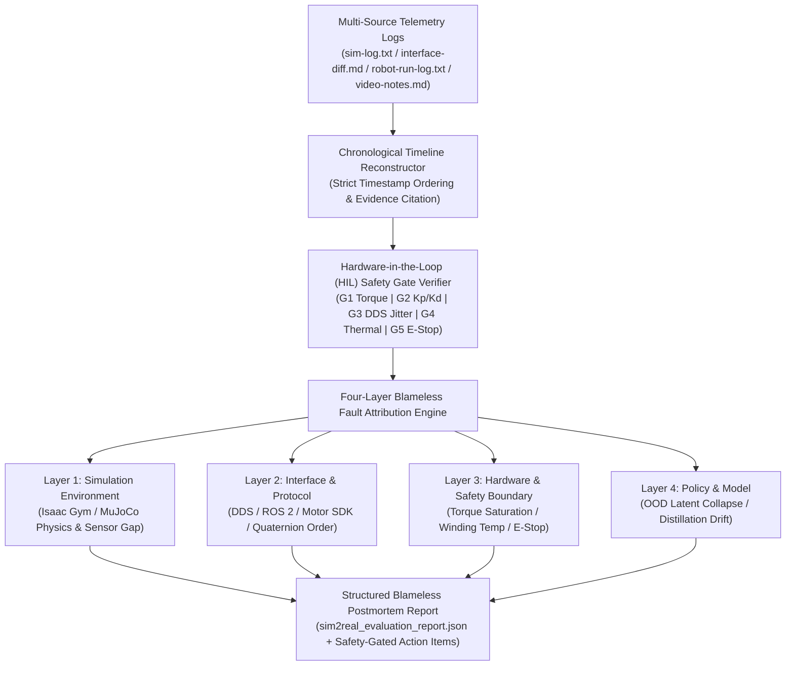

# Four-Layer Blameless Postmortem & Humanoid Sim-to-Real Evaluation Harness
# 具身智能人形机器人 Sim-to-Real 四层无责复盘与硬件在环安全门评测框架

[](https://orcid.org/0009-0004-7641-4450)
[](https://yixinzhangagent.github.io)
[](https://github.com/yixinzhangagent/embodied-sim2real-harness)
[](https://g.dev/updatezhang)
[](https://opensource.org/licenses/Apache-2.0)
[](https://www.python.org/)
[](https://github.com/yixinzhangagent/embodied-sim2real-harness)
[](https://doi.org/10.48550/arXiv.2512.05576)

> **Author / 作者**: **Yixin Zhang (张益新)**  
> **Affiliation / 机构**: **Yuansiwujie (源思无界)**  
> **ORCID**: [`https://orcid.org/0009-0004-7641-4450`](https://orcid.org/0009-0004-7641-4450)  
> **Email / 邮箱**: [`zyxcambridge@gmail.com`](mailto:zyxcambridge@gmail.com)  
> **Homepage / 个人主页**: [`https://yixinzhangagent.github.io`](https://yixinzhangagent.github.io)  
> **GitHub**: [`https://github.com/yixinzhangagent`](https://github.com/yixinzhangagent)  
> **Developer Profile (GDE)**: [`https://g.dev/updatezhang`](https://g.dev/updatezhang)

---

## 1. Overview / 项目概述

**English**:  
Deploying reinforcement learning (RL) whole-body locomotion and manipulation policies from high-throughput physics simulators (**NVIDIA Isaac Gym** / **MuJoCo**) onto physical humanoid hardware (**Unitree G1**) is notoriously brittle. When a Sim-to-Real failure occurs on physical hardware—such as high-frequency ankle chatter, mid-stride thermal knee collapse, or unexpected roll divergence—ad-hoc debugging often conflates reward design bugs with low-level communication jitter, coordinate frame inversions, or actuator saturation.

This repository provides a deterministic, reproducible **Four-Layer Blameless Postmortem & Humanoid Sim-to-Real Evaluation Harness** (`embodied-sim2real-harness`), featuring:
1. **Four-Layer Blameless Postmortem & Fault Attribution Engine**: Reconstructs timestamp-verified incident timelines across multi-source telemetry logs (`sim-log.txt`, `interface-diff.md`, `robot-run-log.txt`, `video-notes.md`) and orthogonally attributes failures across **Simulation Environment**, **Interface & Communication Protocol**, **Hardware & Safety Boundary**, and **Policy & Model**, strictly separating **Root Causes** from **Contributing Factors** under a verifiable blameless engineering standard.
2. **Hardware-in-the-Loop (HIL) Safety Gate Verifier**: Evaluates 5 real-time physical safety boundaries (joint torque limits, PD impedance stability ratio $K_p/K_d$, DDS/ROS 2 communication jitter & packet loss, motor winding thermal derating, and emergency stop trigger latency).
3. **20-Trace Unitree G1 Sim-to-Real Benchmark (`sample_postmortem_traces.json`)**: Covers 5 core humanoid locomotion regimes: **Standing Balance**, **Continuous Walking**, **Smooth Stopping**, **External Perturbation Rejection**, and **Fall Recovery**.

**中文**:  
将强化学习（RL）全身运动控制策略从高吞吐物理仿真器（**Isaac Gym** / **MuJoCo**）迁移部署至真实人形机器人（**Unitree G1**）时，Sim-to-Real 失败往往涉及多源耦合因素。踝关节高频震颤、膝关节热降额塌陷或推搡恢复发散等事故，常被笼统归结为“模型策略不鲁棒”或“操作失误”，缺乏可复现的系统级根因拆解。

本仓库开源了**具身智能人形机器人 Sim-to-Real 四层无责复盘与硬件在环（HIL）安全门评测框架**：
1. **四层无责故障归因引擎（Four-Layer Blameless Postmortem Engine）**：基于多源带时间戳日志（`sim-log.txt`、`interface-diff.md`、`robot-run-log.txt`、`video-notes.md`）自动重建事件序列，将异常正交解耦至**仿真环境层**、**接口与通信协议层**、**硬件与安全边界层**及**模型策略层**，严格区分**根本原因（Root Cause）**与**促成因素（Contributing Factors）**，并内置无责措辞审计。
2. **硬件在环（HIL）五重安全门校验器（Safety Gate Verifier）**：对关节峰值力矩、PD 阻抗刚度阻尼比 $K_p/K_d$、DDS/ROS 2 通信抖动与丢包率、电机绕组温升降额阈值及急停（E-Stop）触发延迟进行确定性校验。
3. **20 组 Unitree G1 真机部署基准轨迹集（`sample_postmortem_traces.json`）**：覆盖**站立平衡**、**连续行走**、**平滑减速驻停**、**外力推搡抗扰恢复**与**跌倒保护恢复**五大典型任务。

---

## 2. Architecture & Four-Layer Attribution Taxonomy / 四层归因架构与安全门规范



### 2.1 Orthogonal Four-Layer Fault Taxonomy / 四层正交归因定义

| Layer | Layer Name (English / 中文) | Characteristic Telemetry Signatures | Representative Unitree G1 Failure Mode |
| :--- | :--- | :--- | :--- |
| **Layer 1** | **Simulation Environment**<br>仿真环境层 (`Isaac Gym / MuJoCo`) | Unmodeled floor friction ($\mu < 0.25$), missing URDF self-collision capsules, zero transport delay assumption | Foot slip on dust-coated epoxy (`G1-S2R-006`), braking pitch overshoot (`G1-S2R-011`), forearm-knee self-collision (`G1-S2R-019`) |
| **Layer 2** | **Interface & Communication Protocol**<br>接口与通信协议层 (`DDS / ROS 2 / SDK`) | Quaternion convention mismatch (`[w,x,y,z]` vs `[x,y,z,w]`), CycloneDDS Wi-Fi jitter spikes, LPF phase lag | 180° roll inversion (`G1-S2R-002`), 18.4 ms Wi-Fi bridge jitter (`G1-S2R-007`), 10 Hz gyro LPF delay (`G1-S2R-015`) |
| **Layer 3** | **Hardware & Safety Boundary**<br>硬件与安全边界层 (`Thermal / Torque / E-Stop`) | Excessive stiffness-to-damping ratio $K_p/K_d$, winding temperature $>75^\circ\text{C}$, blocking I/O in safety thread | 28 Hz ankle resonance (`G1-S2R-003`), 79.4°C knee thermal derating (`G1-S2R-008`), 22.5 ms E-Stop delay (`G1-S2R-018`) |
| **Layer 4** | **Policy & Model**<br>模型策略层 (`RL Locomotion / Distillation`) | Out-of-distribution (OOD) latent trajectory drift, ungated periodic phase clock at zero velocity | In-place marching drift (`G1-S2R-010`), student TCN collapse under 60N dorsal push (`G1-S2R-014`) |

### 2.2 Hardware-in-the-Loop (HIL) Safety Gates / 硬件在环五重安全门

| Gate ID | Gate Name | Deterministic Criterion | Physical Protection Objective |
| :--- | :--- | :--- | :--- |
| **`G1_TORQUE_LIMIT`** | Joint Torque Envelope Gate | $\tau_{\text{peak}} \le \tau_{\text{limit}}$ ($88.0\text{ Nm}$ hip/knee, $45.0\text{ Nm}$ ankle) | Prevents gearbox tooth shear and MOSFET over-current |
| **`G2_PD_IMPEDANCE`** | PD Impedance Stability Gate | $K_p \in [20, 180],\ K_d \in [1, 12],\ K_p / K_d \le 35.0$ | Suppresses high-frequency discrete-time limit-cycle oscillation |
| **`G3_COMM_JITTER`** | DDS/ROS 2 Real-Time Jitter Gate | $\Delta t_{\text{jitter}} \le 5.0\text{ ms} \land \text{Loss} \le 1.0\%$ | Guarantees phase margin across 500 Hz motor servo loops |
| **`G4_THERMAL_BOUND`** | Winding Thermal Derating Gate | $T_{\text{winding}} \le 75.0^\circ\text{C}$ | Prevents sudden firmware current derating mid-stride |
| **`G5_ESTOP_LATENCY`** | E-Stop & Damping Latency Gate | $\Delta t_{\text{estop}} \le 15.0\text{ ms}$ (when triggered) | Ensures non-blocking transition to protective damping prior to impact |

---

## 3. Benchmark Evaluation Results (20 Unitree G1 Traces) / 20组基准评测结果

### 3.1 Task Category Breakdown / 任务类别汇总

| Task Category / 任务场景 | Total Traces | Nominal `PASS` | `INCIDENT_ABORT` | Primary Fault Layers Represented |
| :--- | :---: | :---: | :---: | :--- |
| **Standing Balance (`standing_balance`)** | 4 | 2 | 2 | Layer 2 (Quaternion Order), Layer 3 ($K_p/K_d$ Resonance) |
| **Continuous Walking (`continuous_walking`)** | 4 | 1 | 3 | Layer 1 (Epoxy Friction), Layer 2 (DDS Jitter), Layer 3 (Thermal) |
| **Smooth Stopping (`smooth_stopping`)** | 4 | 2 | 2 | Layer 4 (Ungated Phase Clock), Layer 1 (Actuator Delay) |
| **Perturbation Rejection (`external_perturbation_rejection`)** | 4 | 2 | 2 | Layer 4 (Student OOD Drift), Layer 2 (Gyro LPF Delay) |
| **Fall Recovery (`fall_recovery`)** | 4 | 2 | 2 | Layer 3 (Safety Thread Block), Layer 1 (Self-Collision Mesh) |
| **Total / 合计** | **20** | **9 (45.0%)** | **11 (55.0%)** | **100% Blameless Audit Verified (`20/20`)** |

### 3.2 Per-Trace Evaluation Summary Table / 逐轨迹评测与归因明细

| Trace ID | Task Category | Status | HIL Gates | Primary Root-Cause Attribution Layer | Key Telemetry Evidence |
| :--- | :--- | :---: | :---: | :--- | :--- |
| `G1-S2R-001` | `standing_balance` | `PASS` | `5/5 PASS` | `NONE (Nominal Deployment)` | Peak $\tau = 34.2\text{ Nm}$, RMSE $0.018\text{ rad}$ |
| `G1-S2R-002` | `standing_balance` | `INCIDENT_ABORT` | `5/5 PASS` | **Layer 2: Interface & Protocol** | `[w,x,y,z]` vs `[x,y,z,w]` roll inversion |
| `G1-S2R-003` | `standing_balance` | `INCIDENT_ABORT` | `TRIP(G1,G2)` | **Layer 3: Hardware & Safety** | $K_p/K_d = 91.7 > 35.0$, ankle $\tau = 52.8\text{ Nm}$ |
| `G1-S2R-004` | `standing_balance` | `PASS` | `5/5 PASS` | `NONE (Nominal Deployment)` | 20 mm EVA foam mat stance stable |
| `G1-S2R-005` | `continuous_walking` | `PASS` | `5/5 PASS` | `NONE (Nominal Deployment)` | $0.8\text{ m/s}$ corridor walk, $\tau = 64.5\text{ Nm}$ |
| `G1-S2R-006` | `continuous_walking` | `INCIDENT_ABORT` | `5/5 PASS` | **Layer 1: Simulation Environment** | Dust epoxy $\mu=0.22$ outside $[0.60, 1.25]$ |
| `G1-S2R-007` | `continuous_walking` | `INCIDENT_ABORT` | `TRIP(G3)` | **Layer 2: Interface & Protocol** | Wi-Fi DDS jitter $18.4\text{ ms}$, loss $4.2\%$ |
| `G1-S2R-008` | `continuous_walking` | `INCIDENT_ABORT` | `TRIP(G4)` | **Layer 3: Hardware & Safety** | Knee winding $79.4^\circ\text{C} > 75.0^\circ\text{C}$ |
| `G1-S2R-009` | `smooth_stopping` | `PASS` | `5/5 PASS` | `NONE (Nominal Deployment)` | $1.0 \to 0.0\text{ m/s}$ capture in 2 steps |
| `G1-S2R-010` | `smooth_stopping` | `INCIDENT_ABORT` | `5/5 PASS` | **Layer 4: Policy & Model** | Phase clock active at $\lVert v_{\text{cmd}}\rVert < 0.05\text{ m/s}$ |
| `G1-S2R-011` | `smooth_stopping` | `INCIDENT_ABORT` | `TRIP(G1)` | **Layer 1: Simulation Environment** | Unmodeled $12\text{ ms}$ delay, hip $\tau = 91.5\text{ Nm}$ |
| `G1-S2R-012` | `smooth_stopping` | `PASS` | `5/5 PASS` | `NONE (Nominal Deployment)` | Delay-randomized + gated phase lock |
| `G1-S2R-013` | `external_perturbation_rejection` | `PASS` | `5/5 PASS` | `NONE (Nominal Deployment)` | $35\text{ N}$ lateral impulse recovery in $450\text{ ms}$ |
| `G1-S2R-014` | `external_perturbation_rejection` | `INCIDENT_ABORT` | `5/5 PASS` | **Layer 4: Policy & Model** | Student TCN OOD $= 0.92$ under $60\text{ N}$ push |
| `G1-S2R-015` | `external_perturbation_rejection` | `INCIDENT_ABORT` | `TRIP(G1)` | **Layer 2: Interface & Protocol** | $10\text{ Hz}$ Butterworth LPF added $35\text{ ms}$ delay |
| `G1-S2R-016` | `external_perturbation_rejection` | `PASS` | `5/5 PASS` | `NONE (Nominal Deployment)` | Matched $40\text{ Hz}$ gyro filter, $65\text{ N}$ push pass |
| `G1-S2R-017` | `fall_recovery` | `PASS` | `5/5 PASS` | `NONE (Nominal Deployment)` | Protective squat lowered CoM by $18\text{ cm}$ |
| `G1-S2R-018` | `fall_recovery` | `INCIDENT_ABORT` | `TRIP(G1,G5)` | **Layer 3: Hardware & Safety** | Blocking log flush delayed E-Stop to $22.5\text{ ms}$ |
| `G1-S2R-019` | `fall_recovery` | `INCIDENT_ABORT` | `5/5 PASS` | **Layer 1: Simulation Environment** | Disabled forearm-thigh URDF collision pair |
| `G1-S2R-020` | `fall_recovery` | `PASS` | `5/5 PASS` | `NONE (Nominal Deployment)` | Lock-free safety ring buffer + full collision hull |

---

## 4. Quickstart & Reproducibility / 快速开始与一键运行

### Requirements / 环境要求
- Python `>= 3.9` (Zero external third-party dependencies; uses only Python standard library + `dataclasses`).

### Run the Evaluator / 运行评测与复盘归因引擎

```bash
python3 sim2real_harness_evaluator.py
```

Executing `python3 sim2real_harness_evaluator.py` parses `sample_postmortem_traces.json`, runs the 5-gate HIL Safety Gate Verifier and Four-Layer Blameless Postmortem Engine across all 20 Unitree G1 deployment traces, prints the formatted terminal summary table, and generates `sim2real_evaluation_report.json`.

---

## 5. Repository Structure / 仓库文件结构

```text
embodied-sim2real-harness/
├── README.md                        # Bilingual repository documentation (English + 中文)
├── LICENSE                          # Apache-2.0 License
├── CITATION.cff                     # GitHub / Zenodo Citation File Format 1.2.0
├── .zenodo.json                     # Zenodo DOI deposit metadata
├── codemeta.json                    # CodeMeta 2.0 JSON-LD software metadata
├── sim2real_harness_evaluator.py    # Reference implementation of Four-Layer Postmortem & HIL Verifier
├── sample_postmortem_traces.json    # 20 realistic Unitree G1 Sim-to-Real deployment traces
└── sim2real_evaluation_report.json  # Generated full evaluation & attribution report
```

---

## 6. Citation / 引用格式

If you use this evaluation harness, safety gate specification, or four-layer blameless postmortem methodology in your robotics or embodied AI research, please cite:

```bibtex
@software{zhang2026sim2realharness,
  author       = {Zhang, Yixin},
  title        = {{Four-Layer Blameless Postmortem \& Humanoid Sim-to-Real Evaluation Harness}},
  month        = oct,
  year         = 2026,
  publisher    = {Zenodo},
  version      = {1.0.0},
  note         = {Affiliation: Yuansiwujie. ORCID: 0009-0004-7641-4450},
  url          = {https://github.com/yixinzhangagent/embodied-sim2real-harness}
}
```

### Related Work by the Author / 作者相关工作

```bibtex
@article{xie2025cureagent,
  title   = {CureAgent: Training-Free Clinical Reasoning via Model Context Protocol and Augmented Retrieval},
  author  = {Xie, Ting-Ting and Zhang, Yixin},
  journal = {arXiv preprint arXiv:2512.05576},
  year    = {2025},
  doi     = {10.48550/arXiv.2512.05576},
  url     = {https://arxiv.org/abs/2512.05576}
}
```
